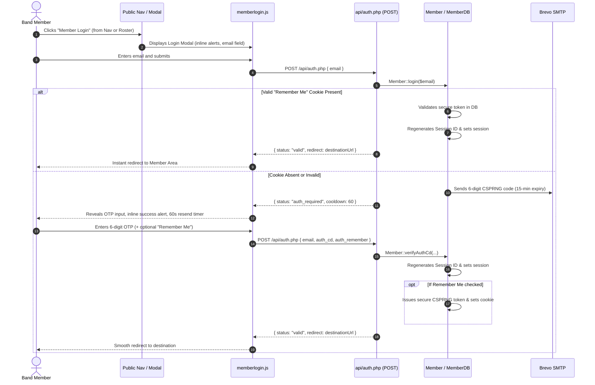

# Keystone Concert Band

Development Repository for the Keystone Concert Band (KCB) Website.

---

## Architecture & Directory Layout

The application is structured into clearly separated modules for public views, member services, AJAX APIs, and static assets:

```
dev/
├── api/                     # Public AJAX endpoints (booking, join, auth, health)
├── assets/                  # Consolidated static web assets
│   ├── css/                 # Stylesheets (site.css, member.css)
│   ├── docs/                # Band policies, bylaws, and uniform guidelines
│   ├── images/              # Logos, slide backgrounds, and conductor photos
│   ├── js/                  # Client-side JavaScript modules
│   └── media/               # Audio sample tracks
├── includes/                # Server-side PHP backend components
│   ├── class/               # Domain classes & DB abstraction layers
│   ├── asset.php            # Cache-busting & SRI asset helper
│   ├── nav.php & footer.php # Reusable layout partials
│   └── common_*.php         # Shared metadata, CSS, and JS includes
├── logs/                    # Application runtime logs (HTTP access denied)
├── members/                 # Authenticated member portal
│   ├── api/                 # Member AJAX endpoints (members, schedule, music, etc.)
│   ├── index.php            # Portal dashboard
│   ├── documents.php        # Member document repository & file manager
│   ├── music.php            # Sheet music catalogue
│   └── schedule.php         # Rehearsals and call times
├── roster.php               # Public musician roster page
├── members.php              # Legacy redirect (HTTP 301 to roster.php)
├── index.php                # Public homepage
├── concerts.php             # Public concert schedule
├── conductors.php           # Public conductor bios
├── donate.php               # Public donation details
├── health.php               # System health check page & JSON status endpoint
├── join.php                 # Public membership application form
├── music.php                # Public recording player & track list
├── privacy.php              # Public privacy policy
├── composer.json            # Composer dependency manifest
└── vendor/                  # Managed dependencies (git-ignored)
```

---

## Asset Management & Cache Busting

All local assets are referenced through the `asset()` helper function in `includes/asset.php`:

```php
<link href="<?= asset('/assets/css/site.css') ?>" rel="stylesheet">
<script src="<?= asset('/assets/js/book.js', $integrity) ?>" integrity="<?= $integrity ?>" crossorigin="anonymous"></script>
```

- Appends file modification timestamps (`?v=<mtime>`) for automatic cache-busting.
- Dynamically computes SHA-384 Subresource Integrity (SRI) hashes for scripts and styles.
- Provides fallback resolution for legacy asset paths.

---

## Local Development & Docker Setup

The application runs locally using the [`mattrayner/lamp:latest`](https://hub.docker.com/r/mattrayner/lamp) Docker image, which bundles Apache, MySQL, PHP 8.x, Composer, and phpMyAdmin in a single container with multi-architecture support (Apple Silicon & Intel).

### 1. Starting the Container

Run the following command from the repository root to start the LAMP container:

```bash
docker run -d \
  --name kcb-lamp \
  -p 8080:80 \
  -p 3306:3306 \
  -v "$(pwd)":/app \
  -v kcb-mysql-data:/var/lib/mysql \
  mattrayner/lamp:latest
```

> [!TIP]
> To explicitly set your MySQL administrative password upon first initialization, pass the `MYSQL_ADMIN_PASS` environment variable:
> ```bash
> docker run -d \
>   --name kcb-lamp \
>   -p 8080:80 \
>   -p 3306:3306 \
>   -e MYSQL_ADMIN_PASS="your_password" \
>   -v "$(pwd)":/app \
>   -v kcb-mysql-data:/var/lib/mysql \
>   mattrayner/lamp:latest
> ```
> If `MYSQL_ADMIN_PASS` is omitted, the container auto-generates a secure password on first boot. View it using `docker logs kcb-lamp`.

#### Optional: Using Docker Compose
Alternatively, you can manage the container with a `docker-compose.yml` file:

```yaml
services:
  lamp:
    image: mattrayner/lamp:latest
    container_name: kcb-lamp
    ports:
      - "8080:80"
      - "3306:3306"
    volumes:
      - .:/app
      - kcb-mysql-data:/var/lib/mysql
    environment:
      - MYSQL_ADMIN_PASS=your_password

volumes:
  kcb-mysql-data:
```

Start the stack with:
```bash
docker compose up -d
```

---

### 2. Database Configuration

1. **Credentials**: The container's administrative MySQL user is `admin`.
2. **Local Settings**: Configure `includes/class/settings.ini.php` with your container credentials:
   ```ini
   [SQL]
   host = localhost
   user = admin
   password = your_password
   dbname = kcb_prod
   ```
3. **Database Creation**: Create the application database inside the container:
   ```bash
   docker exec -it kcb-lamp mysql -uadmin -p -e "CREATE DATABASE IF NOT EXISTS kcb_prod;"
   ```
4. **Database Import**: Import an existing SQL dump into `kcb_prod`:
   ```bash
   docker exec -i kcb-lamp mysql -uadmin -p kcb_prod < path/to/dump.sql
   ```

---

### 3. Local Access URLs

| Service | Host URL | Description |
| :--- | :--- | :--- |
| **Keystone Concert Band Site** | `http://localhost:8080/` | Main web application (served from `/app`) |
| **System Health Dashboard** | `http://localhost:8080/health.php` | Operational health and diagnostics check |
| **phpMyAdmin** | `http://localhost:8080/pma/` | Web-based MySQL database administration |
| **MySQL Service** | `127.0.0.1:3306` | MySQL server accessible to external GUI clients |

*(If you mapped port `80:80` instead of `8080:80`, replace `8080` with port `80` in the URLs above.)*

---

### 4. Container Management & Testing

- **Lifecycle Commands**:
  ```bash
  # Stop container
  docker stop kcb-lamp

  # Start container
  docker start kcb-lamp

  # View container logs (including initial MySQL credentials)
  docker logs kcb-lamp

  # Open an interactive Bash shell
  docker exec -it kcb-lamp bash
  ```

- **Managing Composer Dependencies**:
  ```bash
  # Run Composer install inside the container
  docker exec -it kcb-lamp composer install
  ```

- **Testing the Daily Log Summary**:
  - In a browser or via `curl`:
    ```bash
    # View summary with dry-run output in plain text
    curl "http://localhost:8080/scripts/daily_log_summary.php?dry-run=1"

    # Run and send issue alert email if issues occurred
    curl "http://localhost:8080/scripts/daily_log_summary.php"

    # Test the cron webhook endpoint
    curl "http://localhost:8080/api/cron/daily_log_summary.php?key=kcb-daily-summary-token"
    ```
  - Via Docker CLI:
    ```bash
    docker exec -it kcb-lamp php /app/scripts/daily_log_summary.php --dry-run
    ```

---

## Composer Setup

The project uses Composer for third-party libraries (e.g. `PHPMailer`, `Monolog`) and class autoloading.

To install dependencies locally:

```bash
composer install
```

The `vendor/` directory is managed by Composer and should not be committed to Git.

---

## Member Authentication & Login Flow

The member portal uses a secure, passwordless authentication mechanism based on email One-Time Passcodes (OTP) and persistent "Remember Me" device recognition:

- **Passwordless Verification**: Members enter their registered email address to receive a cryptographically secure 6-digit OTP code (`random_int`) via email.
- **Expiration & Throttling**: Verification codes are valid for 15 minutes, with a 60-second resend cooldown timer to protect email delivery quotas and prevent spamming.
- **Persistent Device Recognition ("Remember Me")**: When enabled, an RFC 4122 UUID v4 token is generated (`random_bytes(16)`) and stored as an `HttpOnly`, `SameSite=Strict` cookie (`KCB_Cookie`) with a 1-year sliding expiration.
- **Logoff Behavior**: Logging off terminates the active PHP session (`$_SESSION` and session cookie) but preserves the persistent device cookie so returning members on personal devices can sign back in with a single click without re-entering an OTP code.
- **Session Security**: Session IDs are regenerated upon verification (`session_regenerate_id(true)`) to prevent session fixation, and strict anti-caching headers are enforced on all auth endpoints.



---

## Logging & Daily Issue Alerting

The application uses **Monolog** with PSR-3 compliance via `KcbLogger` (`includes/class/kcbLogger.class.php`) and a backward-compatible `Log` facade:
- **Daily Rotating Logs**: Stored as `logs/kcb-YYYY-MM-DD.log` using atomic thread-safe append locks (`LOCK_EX`).
- **Retention**: Older log files beyond 30 days are purged automatically.
- **Global Error Handling**: Uncaught exceptions, PHP warnings/notices, and fatal script terminations are captured automatically.
- **Daily Status & Issue Digest**: A GitHub Actions workflow (`.github/workflows/daily-log-summary.yml`) runs daily to trigger `api/cron/daily_log_summary.php`. A comprehensive HTML daily status digest is emailed to `webmaster@keystoneconcertband.com` (or `ALERT_EMAIL_RECIPIENT`), reporting member logins for the previous day and full categorized breakdowns of any issues detected (or confirming all systems are healthy if 0 issues occurred).
- **Abuse Prevention & Security**:
  - **Environment Control (Disabling in Dev)**: Set `SEND_DAILY_SUMMARY_EMAIL=false` (or `APPSETTING_SEND_DAILY_SUMMARY_EMAIL=false` / `ENABLE_DAILY_SUMMARY_EMAIL=false`) to completely disable email dispatch in development environments while still allowing local CLI `--dry-run` inspection.
  - **Single Email Per Day Lock**: Enforces a daily lock (`logs/.sent_YYYY-MM-DD.lock`) so subsequent executions on the same day skip email dispatch, preventing duplicate emails or quota exhaustion from repeated hits. Use `--force` (or `&force=1` with valid key) to explicitly override.
  - **Public Web Access Blocking**: `scripts/.htaccess` blocks all public internet access to the `scripts/` directory at the Apache layer (allowing only local/private subnets).
  - **Token & Role Verification**: `api/cron/daily_log_summary.php` requires a valid authentication key (`?key=...` or `Authorization: Bearer <key>`) matching `APPSETTING_CRON_KEY`. In `scripts/daily_log_summary.php`, non-CLI web execution requires an active admin session, a valid key, or local development environment.
  - **Rate Limiting**: Limits requests to 10 per hour per IP to guard against brute-force or denial-of-service attempts.
  - **Security Auditing**: Unauthorized access attempts are recorded to the daily log as `WARNING` events with client IP and request details.
- **CLI & Web Execution**: The summary script can be triggered via CLI inside the container or directly over HTTP:
  ```bash
  # Inside Docker container:
  php /app/scripts/daily_log_summary.php [--date=YYYY-MM-DD] [--force] [--dry-run]

  # Or via HTTP:
  curl "http://localhost/scripts/daily_log_summary.php?dry-run=1"
  ```

---

## Health Checks & Monitoring

The application provides a real-time system health check page and JSON probe:

- **Web Browser Interface**: `http://localhost/health.php`
  - Displays real-time operational status for MySQL database connectivity, storage write permissions, PHP runtime metrics, and server environment.
- **Automated Monitoring / Probes**: `http://localhost/api/health.php` or `http://localhost/health.php?format=json`
  - Returns structured JSON payload with HTTP `200 OK` when healthy and HTTP `503 Service Unavailable` when degraded.
  - Ideal for Azure Web App Health Check feature, Pingdom, UptimeRobot, or external alerting probes:
    ```bash
    curl "http://localhost/health.php?format=json"
    curl "http://localhost/api/health.php"
    ```
- **Privacy & Information Masking**: Sensitive infrastructure parameters (database hostnames/names, exact PHP patch versions, memory limits, internal filesystem paths, server hostnames, and raw SQL exceptions) are masked from unauthenticated public visitors and exposed only to authenticated band members/administrators or probes with a valid key (`?key=...`).

> [!IMPORTANT]
> **Azure App Service & Nginx**: Azure Web Apps (Linux) runs on **Nginx** (e.g. `nginx/1.30.x`) and **does not process Apache `.htaccess` files**. Extensionless URLs such as `/health` will return an HTTP 404 from Nginx. Always configure Azure Health Check probes and links to use the explicit file path (`/health.php` or `/api/health.php`).

---

## Deployment

The website is continuously deployed to Azure Web Apps via GitHub Actions workflows:
- `dev` branch $\rightarrow$ `webserver-dev`
- `main` branch $\rightarrow$ `webserver-prod`

> [!NOTE]
> Azure Web Apps runs on a Linux container with **Nginx + PHP-FPM**. Apache `.htaccess` directives (such as URL rewriting or `<FilesMatch>` blocks) are not evaluated by Nginx on Azure. If Nginx-level rewrite rules or server directives are required in Azure, they must be configured via custom Nginx configuration or an Azure startup script.
